# NormaCase

**Nachvollziehbare Entscheidungsunterstützung für die sozialmedizinische Begutachtung.**
NormaCase prüft Anträge nach festen, versionierten Regeln und zeigt zu jedem Ergebnis den vollständigen Entscheidungspfad. Fehlen Angaben, entsteht eine gezielte Rückfrage; widersprechen sich Belege, entscheidet ein Mensch.

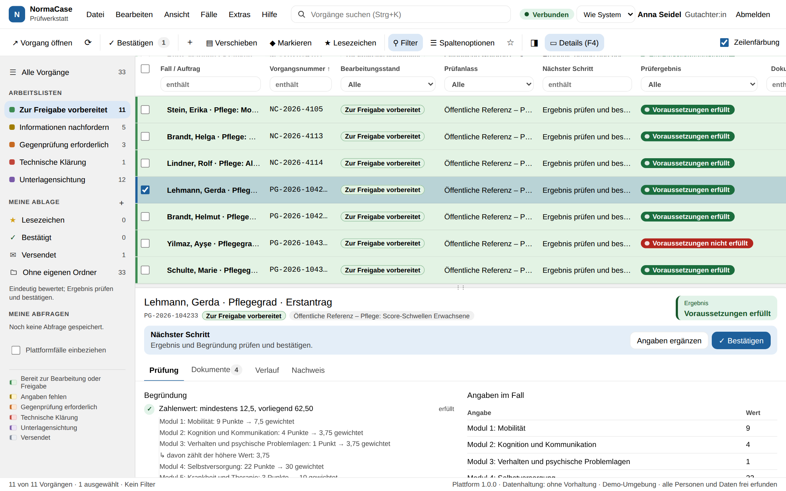

> Alle Personen, Befunde und Vorgänge in diesem Repository sind frei erfunden. Die Regeln bilden öffentliche Vorgaben vereinfacht nach und sind kein geprüftes Regelwerk eines Medizinischen Dienstes.

**Angular · TypeScript · RxJS · Java 25 · Spring Boot 4.1 · PostgreSQL 17 · Docker · Kubernetes**

| | |
|---|---|
| 118 Paritätsfälle exakt wie die frühere .NET-Engine | 132 fiktive Demo-Vorgänge in allen Arbeitslisten |
| Bewertung p95 rund 5 ms (k6 in der CI) | Barrierefreiheit mit axe geprüft |

## Drei Wege eines Antrags

| Eindeutig | Unvollständig | Widersprüchlich |
|---|---|---|
| 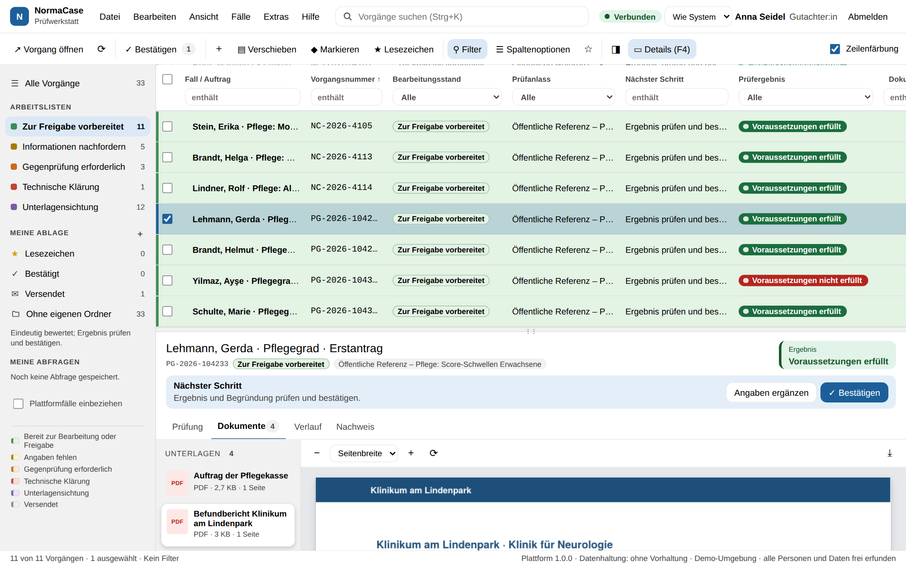 | 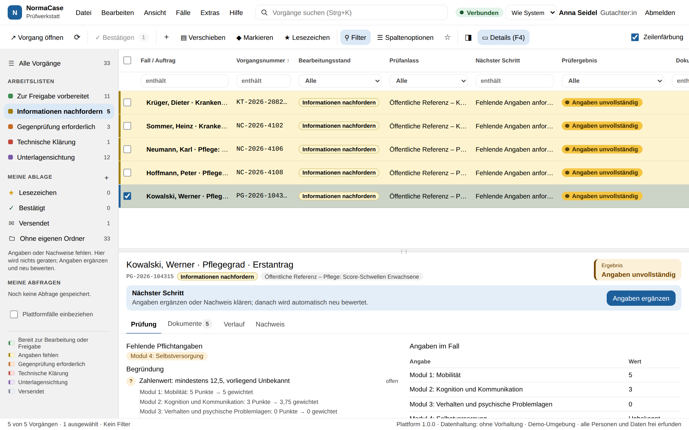 | 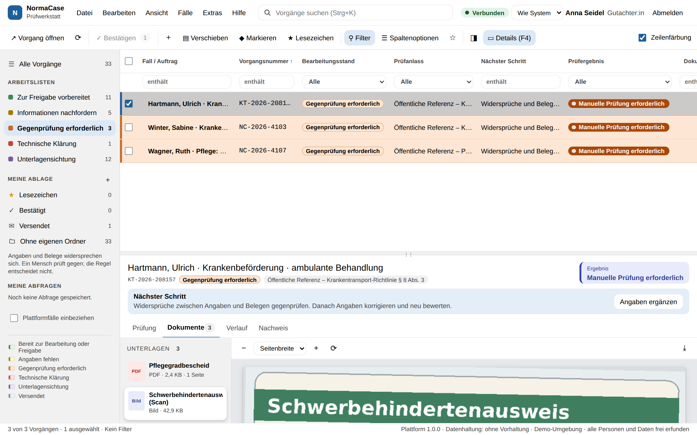 |
| Gerda Lehmann: 62,5 Punkte, Pflegegrad 3. Regel, Fassung und Quelle stehen am Ergebnis. | Werner Kowalski: Modul 4 fehlt. NormaCase fragt genau diesen Wert nach und bewertet dann neu. | Ulrich Hartmann: Angabe und Ausweis passen nicht zusammen. Ein Mensch entscheidet. |

| Angaben ergänzen | Vier-Augen-Freigabe | Nachweis ohne Fallinhalt |
|---|---|---|
| 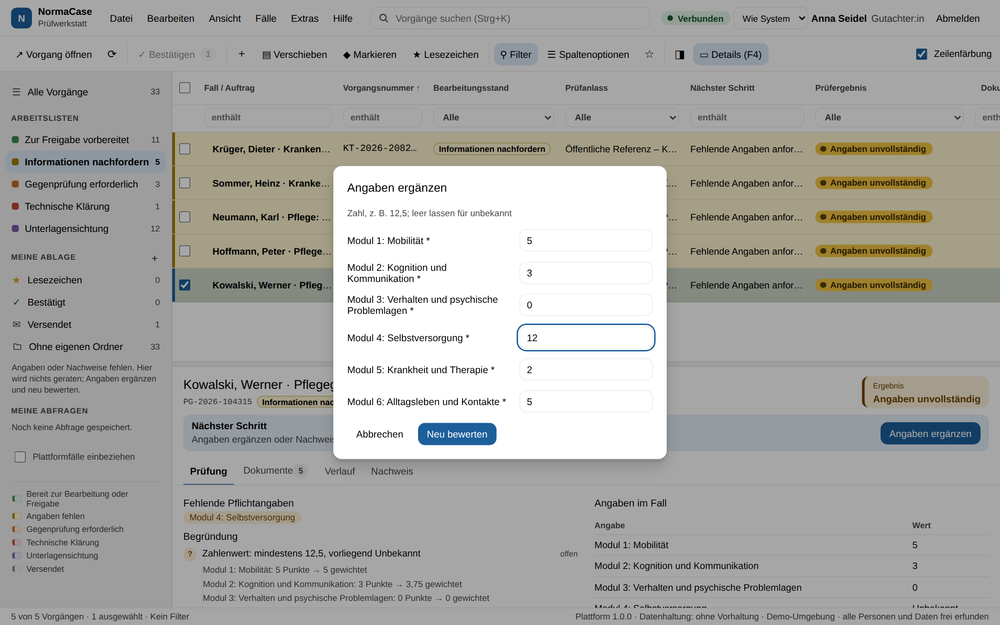 | 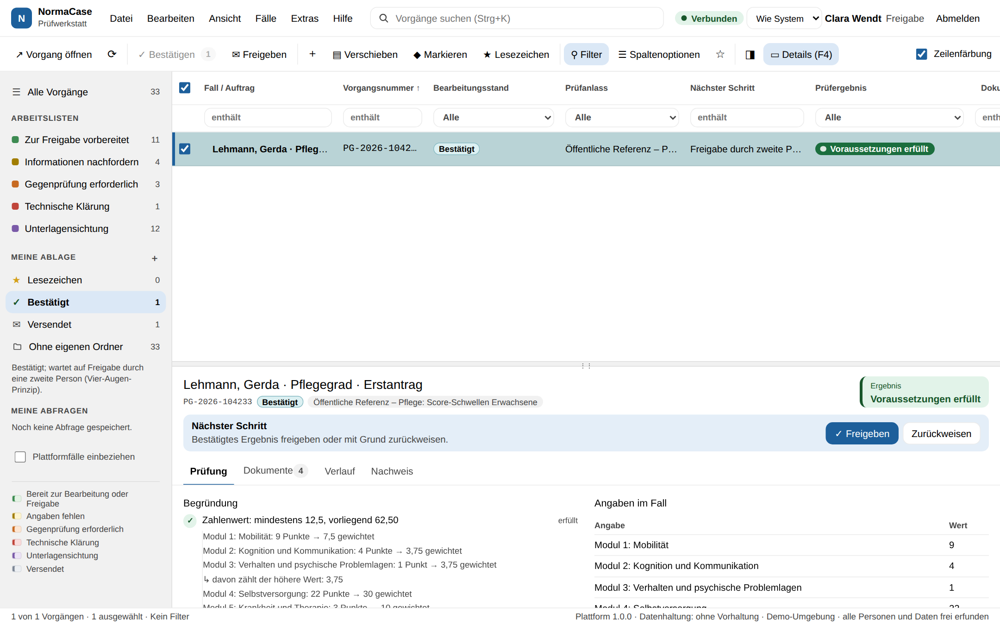 | 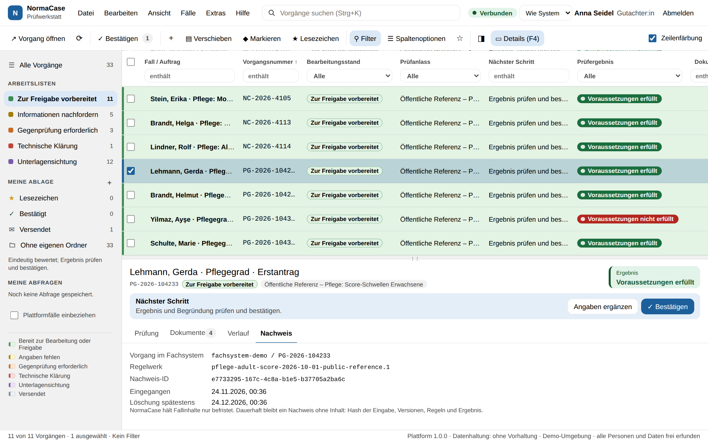 |

## Arbeiten wie im Fallexplorer

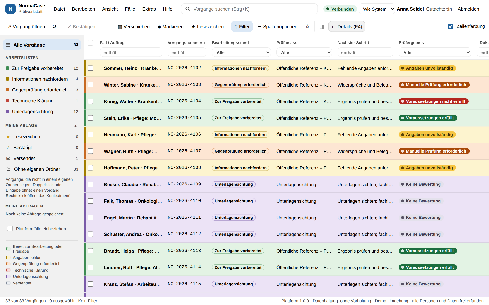

- **Arbeitslisten** nach Bearbeitungsstand: Zur Freigabe vorbereitet, Informationen nachfordern, Gegenprüfung erforderlich, Technische Klärung, Unterlagensichtung; dazu Bestätigt und Versendet.
- **Fallliste wie eine Abfrage in Azure DevOps**: Zeilenfärbung (abschaltbar), Spaltenoptionen, Filter je Spalte, Sortierung, gespeicherte Abfragen. Vorschau unten oder rechts, Größe per Trenner, Fallakte per F4 aus- und einblenden, Doppelklick öffnet die Vollansicht.
- **Meine Ablage** je Konto: eigene Ordner mit Unterordnern und Farben, Lesezeichen, Farbmarkierung, Notizen, eigene Arbeitslistenfarben. Alles auch per Rechtsklick (oder Umschalt+F10).
- **Hell, dunkel oder wie das System**, mit einer gemeinsamen Farbfamilie für Arbeitslisten und Markierungen.

| Rechtsklick-Menü und Meine Ablage | Dunkelmodus |
|---|---|
| 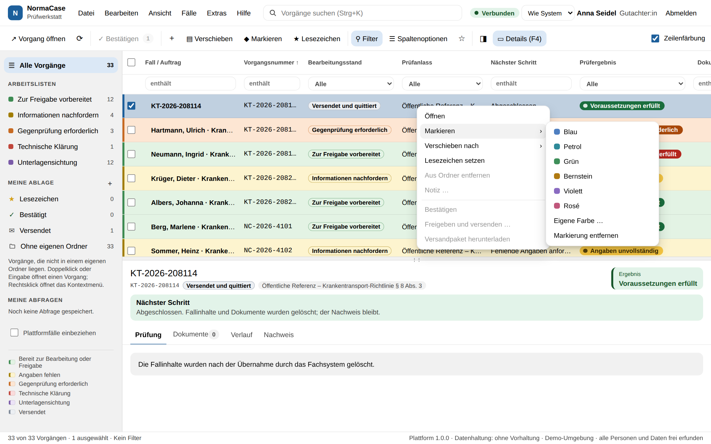 | 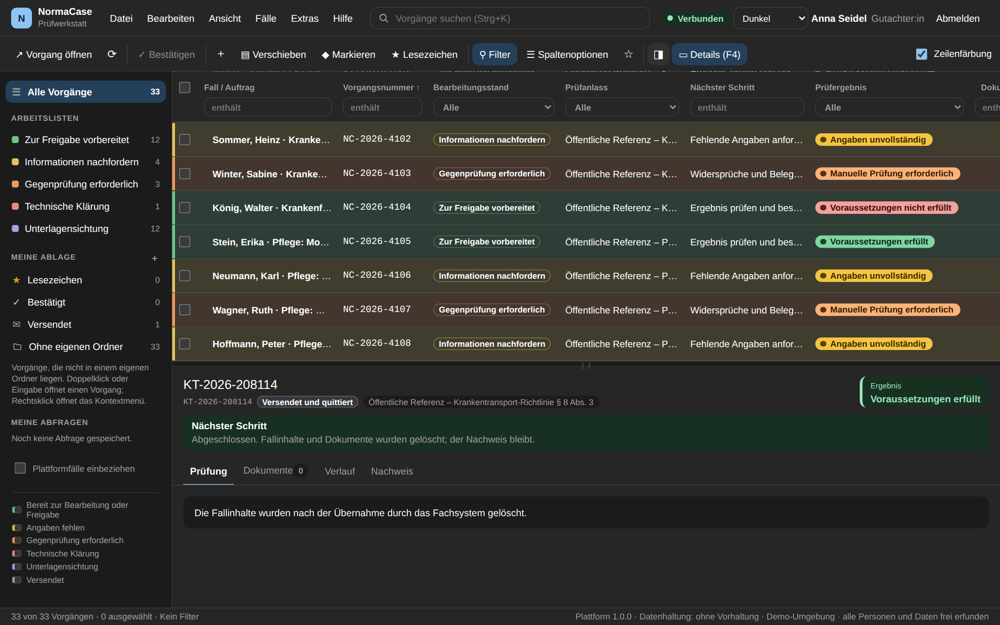 |

## Extras

| Prüfwerkstatt | Referenzfälle |
|---|---|
| 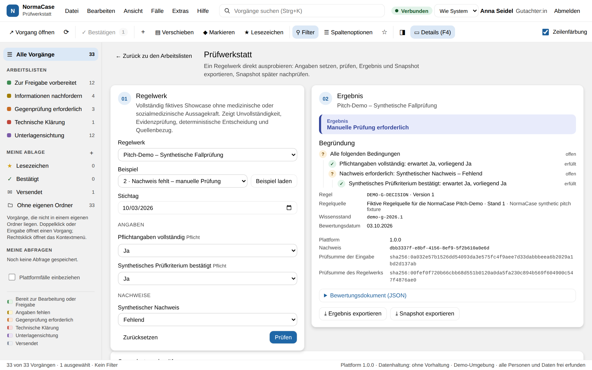 | 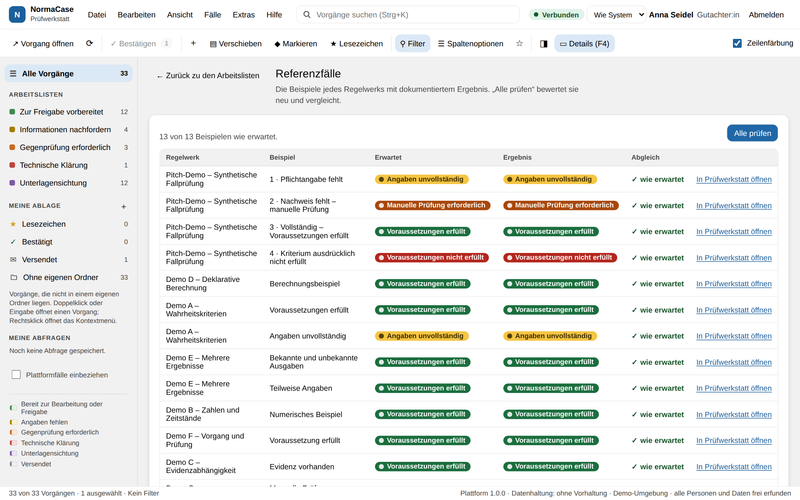 |

- **Prüfwerkstatt**: Regelwerk wählen, Beispiel laden, Angaben ändern, prüfen; Ergebnis und Snapshot exportieren, Snapshot später gegen den gespeicherten Nachweis nachprüfen.
- **Referenzfälle**: alle Beispiele der Regelwerke neu bewerten und mit dem dokumentierten Ergebnis abgleichen.
- **Massenfälle**: Plattformfälle nach Arbeitsliste und Ergebnis.
- **Nachweise prüfen**: Entscheidungsnachweise eines Vorgangs, ohne Fallinhalt.

Die Screenshots entstehen bei jedem Build automatisch aus dem laufenden Stack (`frontend/e2e/zz-screenshots.spec.ts`).

## Lokal starten

Voraussetzung ist Docker (unter Windows Docker Desktop). Dann reicht ein Befehl:

| System | Befehl |
|---|---|
| Windows | Doppelklick auf `demo.cmd` oder in PowerShell `.\demo.ps1` |
| macOS, Linux | `pwsh ./demo.ps1` oder `docker compose up --build` |

Das Skript startet Docker Desktop bei Bedarf, baut und startet PostgreSQL, Keycloak, Backend, Oberfläche und eine Fachsystem-Attrappe, wartet, bis die 132 Demo-Vorgänge eingeliefert sind, und öffnet die Prüfwerkstatt unter <http://localhost:4200>. Der erste Start dauert einige Minuten.

| Aufruf | Wirkung |
|---|---|
| `.\demo.ps1 -Reset` | alles auf Anfang, alle Vorgänge wieder unbearbeitet |
| `.\demo.ps1 -Stop` | beenden, Stand bleibt erhalten |
| `.\demo.ps1 -Monitoring` | zusätzlich Prometheus und Grafana |

Konten: `gutachterin.a` (prüfen, bestätigen) und `freigabe.c` (freigeben), Passwort jeweils `demo`. Alle Konten stehen in [ops/keycloak](ops/keycloak/README.md).

Vier-Augen-Ablauf ausprobieren:

1. Als `gutachterin.a` anmelden, in „Zur Freigabe vorbereitet“ einen Vorgang per Doppelklick öffnen, Begründung und Dokumente ansehen, **Bestätigen**.
2. Abmelden, als `freigabe.c` anmelden, unter „Bestätigt“ **Freigeben**. Wer bestätigt hat, kann nicht selbst freigeben.
3. Fälle in „Informationen nachfordern“ lassen sich über **Angaben ergänzen** vervollständigen; NormaCase bewertet dann neu. Widersprüche landen in „Gegenprüfung erforderlich“, Vorgänge ohne Regelwerk in „Unterlagensichtung“.

Wer den Stack schon vor dem 21.11.2026 gestartet hatte, setzt die Datenbank einmal zurück (`.\demo.ps1 -Reset`), damit das eingeschränkte Laufzeitkonto angelegt wird.

Mit `docker compose --profile monitoring up --build` kommen Prometheus (<http://localhost:9090>) und Grafana (<http://localhost:3000>, Dashboard „NormaCase – Betrieb“) dazu. Entwicklung ohne Container: [backend/](backend/README.md) und [frontend/](frontend/README.md).

## So arbeitet NormaCase

1. Ein Fachsystem liefert einen Vorgang über `POST /api/v1/intake` ein (oder bewertet nur, ohne Vorgang, über `POST /api/v1/assessments`).
2. Die Regel-Engine bewertet deterministisch gegen das angegebene Knowledge Release und schreibt einen Nachweis ohne Fallinhalt.
3. Unvollständige Fälle landen in „Informationen nachfordern“, widersprüchliche in „Gegenprüfung erforderlich“, eindeutige in „Zur Freigabe vorbereitet“.
4. Eine Gutachterin bestätigt, eine zweite Person gibt frei.
5. Das Fachsystem holt das Ergebnis ab und quittiert; NormaCase löscht Fall, Identifikationsdaten und Dokumente sofort.

Vertrag: [`openapi.yaml`](backend/src/main/resources/static/api/v1/openapi.yaml) (zur Laufzeit unter `/api/v1/openapi.yaml`).

## Dokumentation

- [System Design](docs/01-system-design.md) – Zweck, Rollen, Anwendungsfälle, Domänenmodell, Qualitätsziele
- [Architektur](docs/02-architektur.md) – Module, Schnittstellen, Datenfluss, Technik
- [Datenschutz und Datenhaltung](docs/03-datenschutz-und-datenhaltung.md) – Verarbeitung ohne Vorhaltung, Zuordnung zu SDM, BSI TR-03161, SGB V
- [Qualität und Betrieb](docs/04-qualitaet-und-betrieb.md) – Auth, Sicherheit, Rate Limiting, Caching, Logs, Monitoring, Tests, Skalierung, Hosting, CI/CD
- [Architekturentscheidungen (ADRs)](docs/adr/)
- [Roadmap](docs/ROADMAP.md) – Phasen und Stand
- [TR-03161-Checkliste](docs/sicherheit/tr-03161-checkliste.md)
- [Betrieb: Kubernetes](ops/k8s/), [Monitoring](ops/monitoring/), [Lasttest](ops/load/)
- [Entwicklungsregeln](AGENTS.md)
